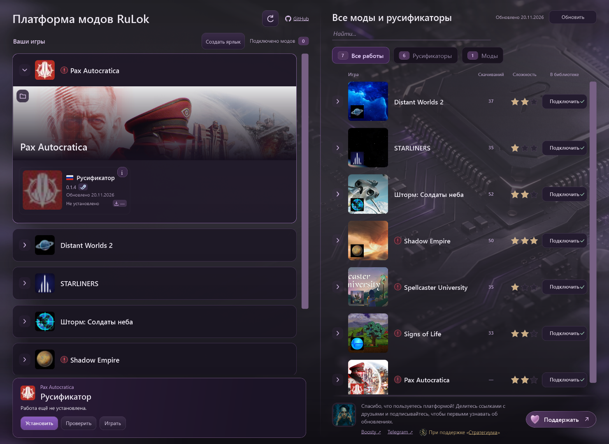
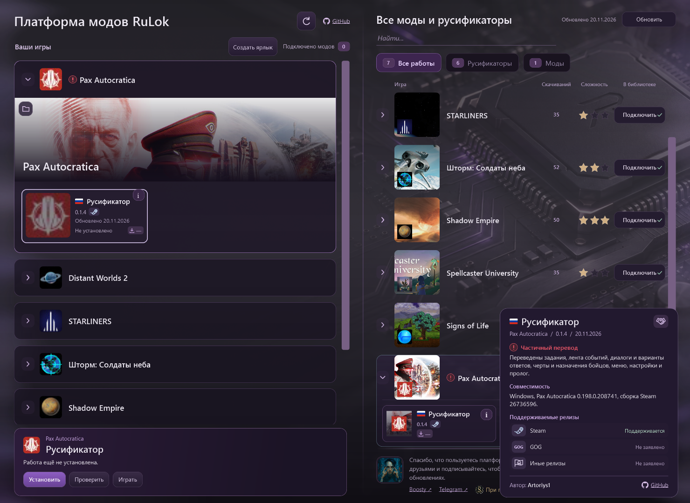

# Мастерская RuLok

Моды и русификаторы Artoriys1.

[Скачать RuLok 0.6.42 для Windows](https://github.com/Artoriys1/RuLok-Releases/releases/download/platform-0-6-42-20261125/RuLok-Platform-0.6.42.zip) ([SHA-256](https://github.com/Artoriys1/RuLok-Releases/releases/download/platform-0-6-42-20261125/RuLok-Platform-0.6.42.zip.sha256))

✅ Для первого запуска распакуйте ZIP целиком в отдельную папку и запустите `Setup-RuLok-Hub-0.6.42.exe`. Можно быстро добавить ярлык на рабочий стол по кнопке «Создать ярлык».

Нажмите на круговую кнопку слева от GitHub, чтобы проверить обновления платформы и скачать их. Если ваша версия RuLok слишком старая для автоматического обновления, [скачайте полный ZIP с GitHub](https://github.com/Artoriys1/RuLok-Releases/releases/download/platform-0-6-42-20261125/RuLok-Platform-0.6.42.zip). Добавляйте игры из правой половины по кнопке «Подключить». Через ту же кнопку можно подключить ещё одну папку той же игры. Постоянно перекачивать архивы вручную для игр или платформы не нужно. Кнопка «Обновить» в правой части подгрузит актуальный список игр и модов для них.

Поле «Найти...» ищет в выбранной вкладке каталога. В карточке подключённой игры нажмите «Проверить», чтобы узнать, доступно ли обновление или требуется повторная установка. Кнопка «Обновить» устанавливает свежий выпуск и поверх старого перевода.

Чтобы отключить игру, нажмите крестик рядом с ней в библиотеке. RuLok удалит её моды и восстановит исходные файлы игры. Сохранения и ваши изменения останутся.

❤️ Поддержать на Бусти — https://boosty.to/neyrodzen

➡️ Подписаться на телеграм, где рассказываю о разработке своей игры и делюсь творчеством — https://t.me/neyrodzen

## Все моды и русификаторы RuLok

- [Distant Worlds 2](catalog/distant-worlds-2/)
- [Signs of Life](catalog/signs-of-life/)
- [STARLINERS](catalog/starliners/)
- [Шторм: Солдаты неба](catalog/echelon-wind-warriors/)
- [Shadow Empire](catalog/shadow-empire/)
- [Spellcaster University](catalog/spellcaster-university/)
